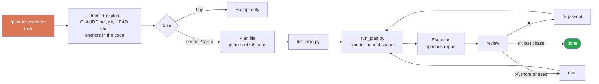

<div align="center">

# 🧠 → 🛠️ plan-for-executor

**A strong model plans. A cheaper model executes. The strong model checks the result.**
A [Claude Code](https://claude.com/claude-code) skill that turns any coding task into a reviewed plan file and a prompt for a fresh session, then reviews what the executor did and hands out the next phase.


</div>

---

## ✨ In 20 seconds

```text
you ──► /plan-for-executor "add pagination to /users"
          │
          ▼
   🧠 PLANNER (e.g. Opus)             reads the repo, edits nothing
          │
          ├──► 📄 plans/2026-10-22-add-pagination.md   (plan + prompt, linted)
          └──► ▶  run_plan.py <plan>                    (opens the executor)
                         │
                         ▼
           🛠️ EXECUTOR (e.g. Sonnet), new session ──► code + execution report
                         │
                         ▼
you ──► /plan-for-executor review <plan>   ✅ ⚠️ ❌ per step, fix prompt if needed
you ──► /plan-for-executor next <plan>     next phase, adjusted to what happened
```

## 🔄 How it works



## 🤔 Why split planning from execution?

| | 🧠 Planner | 🛠️ Executor |
|---|---|---|
| **Job** | Understand, decide, specify, check | Type out a well-specified change |
| **Model** | Strongest you have | Faster / cheaper |
| **Context** | Whole conversation | Only the prompt, fresh session |
| **Touches the repo?** | ❌ Never | ✅ Yes |
| **Output** | Plan file, prompt, review | Code changes + execution report |

## 🛡️ Guarantees

| ✅ The planner does | ❌ The planner never |
|---|---|
| Read code, docs, git history | Edit, create or delete project files |
| Reuse what already exists | Build, install, run tests or commit |
| Ask only when a decision blocks | Spawn subagents |
| Write **one** file: the plan | Invent paths, symbols or commands |

Its `allowed-tools` are read-only for real: no `find` (`-delete`/`-exec`), no `git branch` beyond `--show-current`/`--list`, no output redirection.

What the executor gets so it does not improvise:
- **Base commit**: if the planned files changed since, it stops.
- **Anchors**: every step names the existing line or symbol it starts from.
- **STOP AND REPORT IF**: the assumptions that, if wrong, make the plan wrong.
- **Execution report**: it writes what it did and what deviated back into the plan.

## 📦 Install

```text
/plugin install plan-for-executor --marketplace Ivanzu37/plan-sonnet
```

Or copy the skill folder:

```bash
cp -r skills/plan-for-executor ~/.claude/skills/            # all projects
cp -r skills/plan-for-executor <your-repo>/.claude/skills/  # one project
```

The scripts need Python 3 (standard library only).

## 🚀 Use

```text
/plan-for-executor add pagination to the /users endpoint
/plan-for-executor migrate config loading to env vars ~/code/my-service
/plan-for-executor review plans/2026-10-22-add-pagination.md
/plan-for-executor next plans/2026-10-22-add-pagination.md
```

Installed as a plugin, the command is namespaced: `/plan-for-executor:plan-for-executor`. Asking in plain words ("plan this for Sonnet", "review what Sonnet did") works too.

Start the executor:

```bash
python3 ~/.claude/skills/plan-for-executor/scripts/run_plan.py plans/2026-10-22-add-pagination.md
# --phase N · --review-fix · --model haiku · --cwd DIR · --print (just print the prompt)
```

It lints the plan, picks the current phase and opens `claude --model <executor> "<prompt>"` in the plan's repo. Prefer pasting by hand? `--print`, or copy the block from chat.

## 📄 What you get

### The plan file

```text
plans/2026-10-22-add-pagination.md
├── frontmatter    status · created · repo · branch · commit · phase N/M · executor
├── Context        why, and where it starts from
├── Decisions      chosen / rejected, plus what `next` changed per phase
├── Reuse          existing code to build on
├── Out of scope   what nobody asked for
├── Files          what changes where
├── Steps          ### Phase N → steps with file + anchor
├── Risks          what not to touch
├── Verification   exact commands + expected result
├── Prompt         ### Phase N → one prompt block per phase
├── Execution report   written by the executor
└── Review         written by `review`
```

`status` is one of `draft · approved · in-progress · blocked · done · dropped` (Spanish: `borrador · aprobado · en-curso · bloqueado · hecho · descartado`). Progress lives in `phase`.

A full example with two phases, a report and a review: [`examples/2026-10-22-add-due-dates.md`](examples/2026-10-22-add-due-dates.md).

### The executor prompt

````text
You are working in /abs/path/repo, branch feature/x. Execute phase 1 of 2 of this plan yourself.

CONTEXT            what the project is, what is wanted, why
WORKING MODE       smallest complete change · one slice per step · root cause on failure
BEFORE STARTING    status in-progress · stale check against base commit · files to read
STEPS              1. /abs/file · anchor `def foo(` → concrete change
DO NOT TOUCH       files, branches, project rules
STOP AND REPORT IF assumptions that break the plan
DONE WHEN          [ ] checkable criteria
VERIFY             exact commands → expected result
WHEN FINISHED      execution report · status · no commit unless asked
````

### The lint

```bash
python3 skills/plan-for-executor/scripts/lint_plan.py plans/*.md   # --strict-paths · --json
```

Errors: frontmatter, allowed status values, missing sections, a prompt block per phase, required labels in every block, references to "this conversation". Warnings: paths missing on this machine, relative paths in steps, no commit or branch. The planner runs it before handing off.

## 🎛️ Customize

Put a profile at `~/.claude/plan-for-executor.profile.md` (or point `$PLAN_PROFILE` at one) to set the plans folder, language, executor model, extra frontmatter, and blocks added to every prompt (your formatter, your review command, your log). Start from [`profile.example.md`](skills/plan-for-executor/profile.example.md). A wrapper skill can also point to its own profile: that is how a personal version stays a thin layer over this one instead of a fork.

| Want to change | Where |
|---|---|
| Plans folder, language, executor | profile frontmatter |
| Extra rules in every prompt | profile sections |
| Plan layout, prompt labels | `template.md` |
| Review / next behaviour | `modes/review.md`, `modes/next.md` |
| Planner permissions | `allowed-tools` in `SKILL.md` |

Executor `haiku` → steps carry literal code. A non-Claude executor → no Claude skills or slash commands in the prompt.

## 🧪 Tests

```bash
python3 -m unittest discover -s tests -v                       # scripts, no API calls
claude plugin eval . --scaffold --allow-tools Bash Write Edit  # skill behaviour, uses your quota
```

The evals build toy repos and check that planning never touches code, that the plan passes the lint, that `review` catches a step the executor skipped, and that `next` follows a rename reported in phase 1.

## 📜 License

MIT
