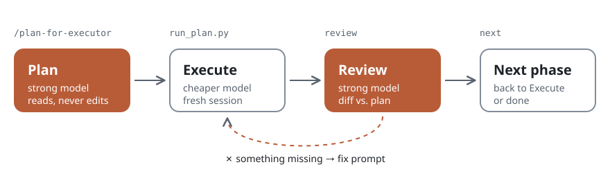

<div align="center">


# plan-for-executor

**Plan with your strongest model. Execute with a cheaper one.**

A Claude Code plugin that turns a coding task into a checked plan and a ready-to-run prompt,<br>
then reviews what the executor did and hands out the next phase. The planner never touches your code.

[](https://github.com/Ivanzu37/plan-for-executor/actions/workflows/test.yml)
[](https://github.com/Ivanzu37/plan-for-executor/releases)
[](LICENSE)

</div>

## Install

```text
/plugin install plan-for-executor --marketplace Ivanzu37/plan-for-executor
```

Then, in any repo:

```text
/plan-for-executor:plan-for-executor add pagination to the /users endpoint
```

You get a plan file, a prompt, and one command that opens the executor with it. Prefer plain words? "Plan this for Sonnet" works too.

## How it works

<picture>
  <source media="(max-width: 600px) and (prefers-color-scheme: dark)" srcset="assets/cycle-vertical-dark.svg">
  <source media="(max-width: 600px)" srcset="assets/cycle-vertical-light.svg">
  <source media="(prefers-color-scheme: dark)" srcset="assets/cycle-dark.svg">
  
</picture>

1. **Plan.** The planner reads the repo, asks only what blocks it, and writes `plans/YYYY-MM-DD-topic.md`: decisions, steps tied to real lines of code, and the executor prompt.
2. **Execute.** `run_plan.py` opens `claude --model sonnet` in the repo with that prompt. The executor works in a fresh session and writes a report back into the plan.
3. **Review.** `/plan-for-executor review <plan>` compares the report and the git diff with the plan, step by step, and writes a fix prompt if something is missing.
4. **Next.** `/plan-for-executor next <plan>` adjusts the following phase to what really happened and hands out its prompt.

In the [eval suite](evals/) (4 cases, 2 runs each) the plugin passes all 8 runs: the planner never edits project code, the guard blocks a shell write, and `review` and `next` catch a skipped step and a renamed function. Without the plugin, Claude fails 3 of the 4 cases.

## Why split planning from execution

| | Planner | Executor |
|---|---|---|
| **Job** | Understand, decide, specify, check | Carry out a well-specified change |
| **Model** | The strongest you have | Faster and cheaper |
| **Context** | The whole conversation | Only the prompt, in a fresh session |
| **Touches the repo** | Never | Yes |
| **Output** | Plan, prompt, review | Code changes and a report |

Expensive reasoning is spent once, where it matters. The executor starts clean and follows the plan literally. And the plan is a file you can read, review and keep.

## What the executor gets

Every prompt is self-contained, with absolute paths and nothing like "as we discussed". It also carries four safeguards so a cheaper model stops instead of improvising:

- **Base commit.** If the planned files changed since the plan was written, it stops.
- **Anchors.** Every step names the existing line or function it starts from.
- **Stop and report if.** The assumptions that, if wrong, make the plan wrong.
- **Execution report.** What it did and what it changed from the plan, written back into the plan file.

A full plan with two phases, a report and a review: [`examples/2026-10-22-add-due-dates.md`](examples/2026-10-22-add-due-dates.md).

## Commands

| Command | What it does |
|---|---|
| `/plan-for-executor <task> [repo]` | Plan a task and hand out the executor prompt |
| `/plan-for-executor review <plan>` | Check the executor's work against the plan |
| `/plan-for-executor next <plan>` | Hand out the next phase of a multi-phase plan |
| `python3 …/scripts/run_plan.py <plan>` | Open the executor session with the current prompt |
| `python3 …/scripts/lint_plan.py <plan>` | Check a plan file |

Installed as a plugin, the slash command is namespaced: `/plan-for-executor:plan-for-executor`. `run_plan.py` options: `--phase N`, `--review-fix`, `--model haiku`, `--cwd DIR`, and `--print` to paste the prompt by hand instead.

## Customize

Add a profile at `~/.claude/plan-for-executor.profile.md`, or point `$PLAN_PROFILE` at one, to set:

- the plans folder, the language and the executor model;
- extra frontmatter for every plan;
- blocks added to every prompt, such as your formatter, your review command or your log.

Start from [`profile.example.md`](skills/plan-for-executor/profile.example.md). A wrapper skill can point to its own profile, so a personal version stays a thin layer instead of a fork.

## Requirements

- Claude Code 2.1 or later.
- Python 3.9 or later for the scripts (standard library only).
- Linux, macOS or Windows. On Windows, hooks run in Git Bash, which Claude Code already needs.

## When not to use it

Skip it for one-line fixes and quick experiments: writing a plan costs more than the change. It pays off when a task spans several files, will take more than one session, or has to be done carefully by a cheaper model.

## Under the hood

- **Read-only planner.** `allowed-tools` only allows reading, plus writing the plan. A `PreToolUse` guard hook (`scripts/guard_readonly.py`) blocks shell writes (`>`, `>>`, `tee`, `sed -i`, `rm`, git commands that change the repo) and edits to anything that is not Markdown while the skill runs.
- **Plan format.** `status` is one of `draft · approved · in-progress · blocked · done · dropped` (Spanish: `borrador · aprobado · en-curso · bloqueado · hecho · descartado`); progress lives in `phase: N/M`. The layout and the prompt template are in [`template.md`](skills/plan-for-executor/template.md).
- **Lint.** `lint_plan.py` checks frontmatter, sections, one prompt block per phase, every prompt label, and references to the planning conversation. The planner runs it before every hand-off.
- **Tests.** Unit tests for the scripts run on Linux, macOS and Windows: `python3 -m unittest discover -s tests`. The behaviour evals build toy repos and use your Claude quota: `claude plugin eval . --scaffold --allow-tools Bash Write Edit --judge-model sonnet` (the default judge is noisier).

## Issues and ideas

Found a bug or have an idea? [Open an issue](https://github.com/Ivanzu37/plan-for-executor/issues/new/choose). The templates ask for what is needed to reproduce it; remove private paths from any plan you paste.

Pull requests are welcome. Keep the planner read-only, and run the unit tests and the lint on `examples/` before sending one.

## License

MIT © Ivanzu37
