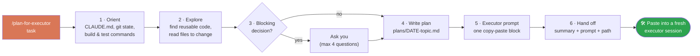

<div align="center">

# 🧠 → 🛠️ plan-for-executor

**A strong model plans. A cheaper model executes.**
A [Claude Code](https://claude.com/claude-code) skill that turns any coding task into a reviewed plan file and a copy-paste prompt for a fresh session.


</div>

---

## ✨ In 20 seconds

```text
you ──► /plan-for-executor "add pagination to /users"
          │
          ▼
   🧠 PLANNER (e.g. Opus)            reads the repo, edits nothing
          │
          ├──► 📄 plans/2026-10-22-add-pagination.md   (the plan, in your repo)
          └──► 📋 a self-contained prompt               (you copy it)
                         │
                         ▼
           🛠️ EXECUTOR (e.g. Sonnet) in a NEW session ──► code changes
```

## 🔄 How it works



## 🤔 Why split planning from execution?

| | 🧠 Planner | 🛠️ Executor |
|---|---|---|
| **Job** | Understand, decide, specify | Type out a well-specified change |
| **Model** | Strongest you have | Faster / cheaper |
| **Context** | Whole conversation | Only the prompt, fresh session |
| **Touches the repo?** | ❌ Never | ✅ Yes |
| **Output** | Plan file + prompt | Code changes |

- 💸 Expensive reasoning is spent once, where it matters.
- 🧹 The executor has no stale context and follows the plan literally.
- 📄 The plan is a file: reviewable, versionable, reusable.

## 🛡️ Guarantees

| ✅ The planner does | ❌ The planner never |
|---|---|
| Read code, docs, git history | Edit, create or delete project files |
| Reuse what already exists | Build, install, run tests or commit |
| Ask only when a decision blocks | Spawn subagents |
| Write **one** file: the plan | Invent paths, symbols or commands |

> Anything it could not verify becomes an explicit **"check first"** step for the executor.

## 📦 Install

```bash
# personal (all projects)
cp -r plan-for-executor ~/.claude/skills/

# or per project
cp -r plan-for-executor <your-repo>/.claude/skills/
```

## 🚀 Use

```text
/plan-for-executor add pagination to the /users endpoint
/plan-for-executor migrate config loading to env vars ~/code/my-service
```

Plans go to `$PLANS_DIR` if set, otherwise `<repo>/plans/`.

Then open a **new session** with your executor model in the repo and paste the prompt.

## 📄 What you get

### The plan file

```text
plans/2026-10-22-add-pagination.md
├── Context        why, and where it starts from
├── Decisions      what was chosen, what was rejected
├── Reuse          existing code to build on
├── Out of scope   what nobody asked for
├── Files          what changes where
├── Steps          small, ordered slices
├── Risks          what not to touch
├── Verification   exact commands + expected result
└── Prompt         the block below, identical
```

### The executor prompt

````text
You are working in /abs/path/repo, branch feature/x. Execute this plan yourself.

CONTEXT         what the project is, what is wanted, why
WORKING MODE    smallest complete change · one slice per step · root cause on failure
BEFORE STARTING files to read · things to check first
STEPS           1. file → concrete change   2. ...
DO NOT TOUCH    files, branches, project rules
DONE WHEN       checkable criteria
VERIFY          exact commands → expected result
WHEN FINISHED   summary · mark plan `status: done` · no commit unless asked
````

Absolute paths only. No "as we discussed". Large task? One prompt per phase.

## 🎛️ Customize

| Want to change | Edit in `SKILL.md` |
|---|---|
| Plan layout | the template in step 4 |
| What the executor must do | the prompt block in step 5 |
| Commit / test / review policy | `WORKING MODE` and `WHEN FINISHED` |
| Planner permissions | the `allowed-tools` line |

## 📜 License

MIT
